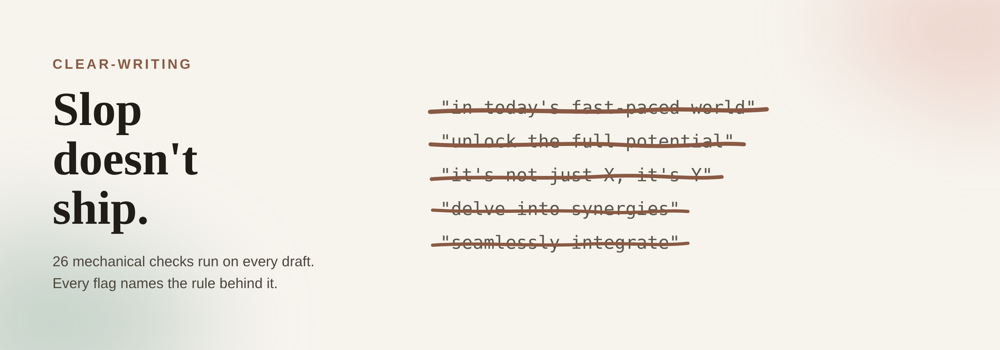

A Claude Code skill that applies a fixed ruleset whenever prose gets written or edited, then checks mechanically that the rules were actually followed rather than trusting the model's own report. It defaults to a style-only pass that never restructures a draft, and only reshapes content when explicitly asked to summarize, recommend, or reformat. A standalone `check.py` script scans for violations — em dashes, invented specifics, unsupported claims, passive voice, buzzwords — independent of whichever assistant produced the draft.

**Tech Stack:** Claude Code Skills · Python (stdlib only) · Markdown-based rule references

**Highlights**

* Mechanical verification layer (`check.py`) instead of relying on self-reported compliance
* Style-only vs. full-rewrite modes, with a word-loss guard to catch unwanted compression
* Six always-on ground rules promoted to `CLAUDE.md`, with the full ~20,000-word ruleset loaded only on demand
* A drift test keeps documented rules and enforced checks from silently diverging
* Six documented eval cases tied to real failures observed during development

[View the code and full write-up on GitHub →](https://github.com/ThorstenWeberGER/writing-skills)
