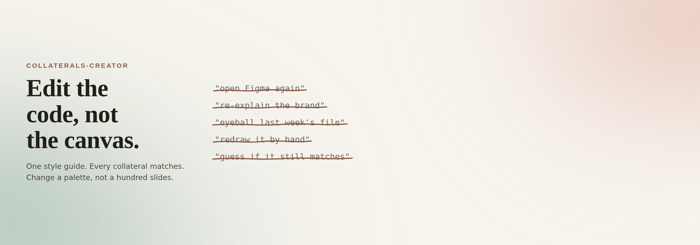

A collection of design systems and generator scripts for marketing collateral, built so a piece can be edited as code and re-rendered rather than redrawn by hand every time it changes. The first system covers LinkedIn carousel PDFs: a documented palette, type scale, and layout, plus a content formula for mapping an article's argument onto a fixed number of slides, and the script that turns that structure into a finished deck.

**Tech Stack:** Python · PDF generation · Design systems documentation

**Highlights**

* Palette, type, and layout rules captured once and reused across every deck
* A repeatable content formula for compressing an article into a short slide sequence
* Script-driven rendering, so updating content means editing text, not artwork
* Each subfolder is self-contained, with its own README covering requirements and usage

[View the code and full write-up on GitHub →](https://github.com/ThorstenWeberGER/collaterals-creator)
