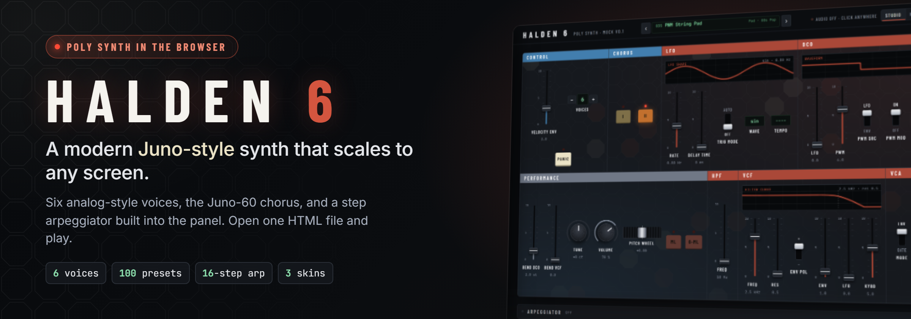

A six-voice polyphonic synthesizer that sounds like the Roland Juno-60, built as a single HTML page. The sound engine is written once in Faust and compiled to WebAssembly for the browser and to C++ for a VST3 plugin in Ableton Live. Both share the same panel, presets and arpeggiator patterns. No install, no server, no account: open the page, tap once, and play.

The sound was measured, not tuned by ear. About 80 public recordings of a real Juno-60 served as the reference. Filter, envelope, oscillator levels and chorus were fitted to them, and gaps were filled from the Juno's published circuit values. The filter's resonance now matches the recordings within 1 dB at every step.

**Tech Stack:** Faust · WebAssembly · JavaScript, HTML & CSS · Web MIDI · JUCE (C++) · Python (audio analysis) · GitHub Actions · Playwright

**Highlights**

* Juno-60 filter, envelope and chorus fitted to hardware recordings, plus reverb, drive and a 2-operator FM layer
* 100 factory presets in 10 categories, searchable from the top bar
* Built-in arpeggiator with a 16-step pattern editor, step recording and 7 factory patterns
* MIDI keyboards and controllers work out of the box, with MIDI learn for any knob or fader
* One panel that scales from phone to studio monitor, with live graphs for every section
* An automated check keeps the web and plugin versions sounding identical, note for note, on every push

[View the code and full write-up on GitHub →](https://github.com/ThorstenWeberGER/halden6)
&nbsp;·&nbsp;
[Play the live synth →](https://thorstenweberger.github.io/halden6/)
&nbsp;·&nbsp;
[Download the plugin for Windows →](https://github.com/ThorstenWeberGER/halden6/releases/latest/download/Halden6-vst3-windows.zip)
